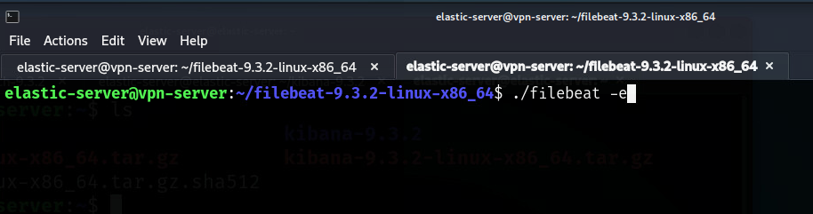

ELK Stack Configuration Guide

This guide explains how to configure a ELK stack, which is one of the popular SIEM solution. ELK stack consist of Elastic Search, Logstash, Beats and Kibana. Out of three listed stack, we install Elastic Search, Kibana and Logstash in our ELK Stack headless server and Beat which is filebeat we have installed in the VPN server, as beat is an agent that needs to be installed inside the vpn server as we forwarding the VPN server log to the Kibana Dashboard.

1. Prerequisites

- A linux server (Headless VPN Server) -> Filebeat will be installed here
- A linux server (Headless ELK Stack Server) -> Logstash, Elastic Search and Kibana will be installed here.
- A attacker device (Kali Linux in our case) -> Metasploit is already installed in kali linux to simulate brute force attack.
- Basic Networking knowledge
- SOC Basic
- Root or sudo access

2. Installation

- On Ubuntu/Debian
  <pre>sudo apt update</pre>
- Refer to following link for configuration.
  - Filebeat -> https://www.elastic.co/docs/reference/beats/filebeat/filebeat-installation-configuration
  - Elasticsearch -> https://www.elastic.co/docs/deploy-manage/deploy/self-managed/installing-elasticsearch
  - Logstash -> https://www.elastic.co/docs/reference/logstash/installing-logstash
  - Kibana -> https://www.elastic.co/docs/deploy-manage/deploy/self-managed/install-kibana

3. Filebeat

- Very important, filebeat agent must be configured in the VPN server cause it is an agent and we are forwarding auth.log and syslog from the VPN server.
- First is installation of the filebeat. In this lab it is downloaded and configured manually. We have downloaded the tar file and run filebeat manually not with the system.
- To download the filebeat, we can go to above link and paste in the terminal as:
- <pre>
  curl -L -O https://artifacts.elastic.co/downloads/beats/filebeat/filebeat-9.3.2-linux-x86_64.tar.gz
  tar xzvf filebeat-9.3.2-linux-x86_64.tar.gz
  </pre>
- Next configure the filebeat.yml file.
  - - [filebeat.yml](../Config/filebeat.yml)
- We are forwarding the log by using filebeat agent via logstash to Kibana dashboard. Filebeat forwards logs to Logstash at 192.168.202.174:5044 in our case. This is all configured in the filebeat.yml
- Run the filebeat as
- <pre>
  ./filebeat -e 
  </pre>
- 

4. Elasticsearch

- Elasticsearch basically is the core engine that stores, indexes, and lets us search our logs. Elasticserch receives processed logs (usually from logstash) and saves them as documentin indices. It acts as a backend from Kibana.
- Install the Elasticsearch, we are downloading and installing manually just like filebeat.
- Recommend to follow the official documentation for installation
- <pre>
    wget https://artifacts.elastic.co/downloads/elasticsearch/elasticsearch-9.3.2-amd64.deb
    wget https://artifacts.elastic.co/downloads/elasticsearch/elasticsearch-9.3.2-amd64.deb.sha512
    shasum -a 512 -c elasticsearch-9.3.2-amd64.deb.sha512
    sudo dpkg -i elasticsearch-9.3.2-amd64.deb
  </pre>
- Next configure the elasticsearch.yml file
- - [elasticsearch.yml](../Config/elasticsearch.yml)
- Run the elastic search
- [Elasticsearch run](../Screenshots/09-elasticsearch.png)
- [Elasticsearch check](../Screenshots/10-elasticsearch-check.png)
- [Elasticsearch check from client machine via server IP](../Screenshots/11-elasticsearch-client-check.png)

5. Generating a private and public key

- For the use in WireGuard, the server and each client must generate their key pair and then exchange public keys. WireGuard works by encrypting the communication by generating the pair of keys.
- For server and client to generate the keys
- <pre>cd /etc/wireguard</pre>
- Set the permissions for the directory: <pre> unmask 077 </pre>
- With the required permission generate the key: <pre>wg genkey | tee privatekey | wg pubkey > publickey <pre> (Repeat the same steps in client)
- 

6. Logstash

- Logstash is a dataprocessing engine that takes data from different sources, filters it, or normalizes it, and then send it to the destination which could be Kibana or a listening port. A logstash configuration file is divided into input, filter and output.
- Follow the official documentation for installation.
- [logstash.conf](../Config/logstash.conf)
- [Logstash Config file location](../Screenshots/12-logstash-conf-file-location.png)
- In the logstash conf file, this is the simple logstash pipeline. It defines where logs come from (input) which is filebeat in our case, filebeat config sends log to the 192.168.202.174:5044. This input receives those logs. Output section shows, logstash sends data to Elasticsearch which is running in http://localhost:9200 and last is the index naming as index => "filebeat-%{+YYYY.MM.dd}"

7. Kibana

- Kibana is a web-based data visualization tool that works with Elasticsearch to analyze, investigate and visualize data stream in real time.
- We can create multiple visualizations and dashboards for better visibility.
- Download the Kibana from the official documentation from the above link.
- Configure the kibana.yml file
- [kibana.yml](../Config/kibana.yml)
- <pre>
  server.host: "0.0.0.0"
  elasticsearch.hosts: ["http://192.168.202.174:9200"]
  </pre>
- After that kibana is running in the browser.
- [Kibana Running Port](../Screenshots/14-kibana-running-port.png)
- [Kibana Web Portal](../Screenshots/15-kibana-web-portal.png)

7. Real Time log monitoring and visualization

- First we will perfrom the brute force attack via metasploit and see the failed login attempts alerts in real time at Kibana web portal and visualize it.

8. Conclusion

- In this lab we have simulated how the real SIEM works and how agent will forward the necessary telemetry to the SIEM dashboard and visualize in real time.
  [Brute Force Attack Visualization](../Video/Brute%20Force%20Attack%20Simulation.mkv)
