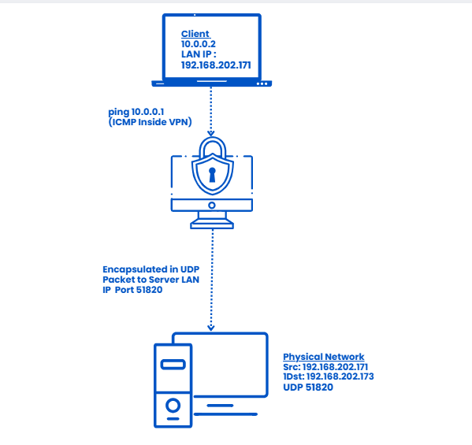
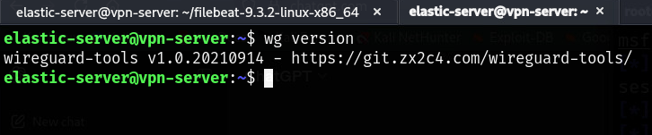
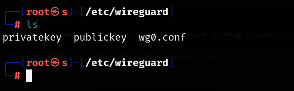
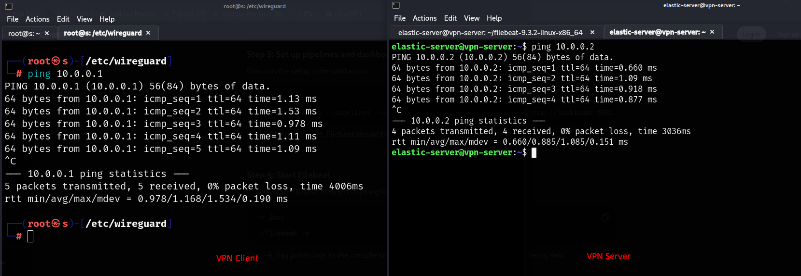
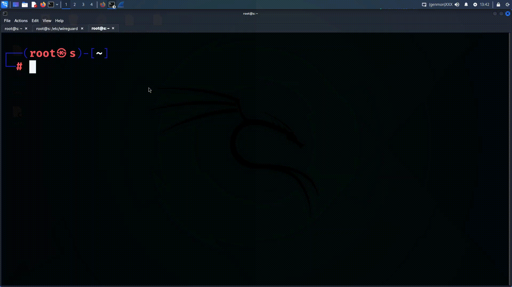

WireGuard VPN Configuration Guide

This guide explains how to configure a WireGuard VPN on both server and client.

- 

1. Prerequisites

- A linux server (Headless)
- A client device (Kali Linux in our case)
- Basic Networking knowledge
- Root or sudo access
- Wireshark

2. Installation

- On Ubuntu/Debian
  <pre>sudo apt update</pre>
  <pre>sudo apt install wireguard -y</pre>
- Refer to this official link -> https://www.wireguard.com/install/
- Verify installation
- <pre>wg version</pre>
- 
- In the logstash conf file, this is the simple logstash pipeline. It defines where logs come from (input) which is filebeat in our case, filebeat config sends log to the 192.168.202.174:5044. This input receives those logs. Output section shows, logstash sends data to Elasticsearch which is running in http://localhost:9200 and last is the index naming as index => "filebeat-%{+YYYY.MM.dd}"

3. IP Forwarding

- Next, to connect through your WireGuard Server, you will need to enable packet forwarding. This is only done on the wireguard server and is not necessary for any client.
  <pre>sudo nano /etc/sysctl.conf</pre>
  Uncomment this line by removing # at the begining of the line<pre>net.ipv4.ip_forward=1</pre>
- Apply the new option using the command <pre>sudo sysctl -p </pre>

4. Configuring Firewall Rule

- Install the ufw
- <pre>sudo apt install ufw</pre>
- <pre>sudo ufw allow ssh</pre>
- <pre>sudo ufw allow 51820/udp</pre>
- Enable the firewall
- <pre>sudo ufw enable</pre>
- Check the status
- <pre>sudo ufw status</pre>

5. Generating a private and public key

- For the use in WireGuard, the server and each client must generate their key pair and then exchange public keys. WireGuard works by encrypting the communication by generating the pair of keys.
- For server and client to generate the keys
- <pre>cd /etc/wireguard</pre>
- Set the permissions for the directory: <pre> unmask 077 </pre>
- With the required permission generate the key: <pre>wg genkey | tee privatekey | wg pubkey > publickey <pre> (Repeat the same steps in client)
- 

6. Generating the server config

- Create a server config file.
- <pre>sudo nano /etc/wireguard/wg0.conf </pre>
- Paste this <pre>
  [Interface]
  PrivateKey = "contents-of-server-privatekey"
  Address = 10.0.0.1/24
  PostUp = iptables -t nat -A POSTROUTING -o ens160 -j MASQUERADE; iptables -A FORWARD -i wg0 -o ens160 -j ACCEPT; iptables -A FORWARD -i ens160 -o wg0 -m state --state RELATED,ESTABLISHED -j ACCEPT
  PostDown = iptables -t nat -D POSTROUTING -o ens160 -j MASQUERADE; iptables -D FORWARD -i wg0 -o ens160 -j ACCEPT; iptables -D FORWARD -i ens160 -o wg0 -m state --state RELATED,ESTABLISHED -j ACCEPT
  ListenPort = 51820

  [Peer]
  PublicKey = "contents-of-client-publickey"
  AllowedIPs = 10.0.0.2/32
  </pre>

- If your default network interface name differs, you might need to check it and replace <pre>eth0</pre> with it in the config above.
- Note that the configuration file must include the actual keys, a string of letters, numbers and symbols. You can read the key files with the following commands.
- <pre> sudo cat /etc/wireguard/publickey
   sudo cat /etc/wireguard/privatekey 
  </pre>

7. Starting WireGuard and enabling it at boot

- With the configuration in place, we are ready to start the server. WireGuard has a convenient wrapper called wg-quick that can be used to start new interfaces without needing to go into the setup details. You can use it to start your configuration using the following command.
  <pre>sudo wg-quick up wg0</pre> For interface up.
  <pre>sudo wg-quick down wg0 </pre> For interface down.
- To enable to start automatically at system boot.
  <pre>systemctl enable wg-quick@wg0</pre>
  <pre>systemctl stop wg-quick@wg0</pre>

8. Client Configuration

- Same <pre>sudo nano /etc/wireguard/wg0.conf</pre>
- Add the following text: -<pre>
  [Interface]
  Address = 10.0.0.2/32
  PrivateKey = "contents-of-client-privatekey"
  DNS = 1.1.1.1

  [Peer]
  PublicKey = "contents-of-server-publickey"
  Endpoint = "server-public-ip":51820
  AllowedIPs = 0.0.0.0/0, ::/0

</pre>
- Same:
- <pre>sudo wg-quick up wg0</pre> For interface up.
  <pre>sudo wg-quick down wg0 </pre> For interface down.
- To enable to start automatically at system boot.
  <pre>systemctl enable wg-quick@wg0</pre>
  <pre>systemctl stop wg-quick@wg0</pre>

9. Connection check.

- Here the client IP is 10.0.0.2 and server IP is 10.0.0.1.(Can be different)
- 

10. Check the VPN tunneling works or not.

- What will happen in this set up is.
  a. Our VPN IPs:
- Server: 10.0.0.1
- Client: 10.0.0.2

b. Our actual LAN IPs:

- Server: 192.168.202.173
- Client: 192.168.202.171

c. Wireguard tunneling behavior:

- When we ping server as 10.0.0.1 from client, the client encapsulates that packet inside an encrypted UDP packets.
- The outer packet use the Client's LAN IP as source (192.168.202.171), and server's LAN IP as destination (192.168.202.173)
- If we check in wireshark, it sees this outer packet, because it captures at the physical interface level.
- Inside that encrypted UDP payload is the actual VPN traffic, i.e ping 10.0.0.1. WireGuard encrypts it, so Wireshark cannot see it unless you decrypt it which is usually not done.
- 
